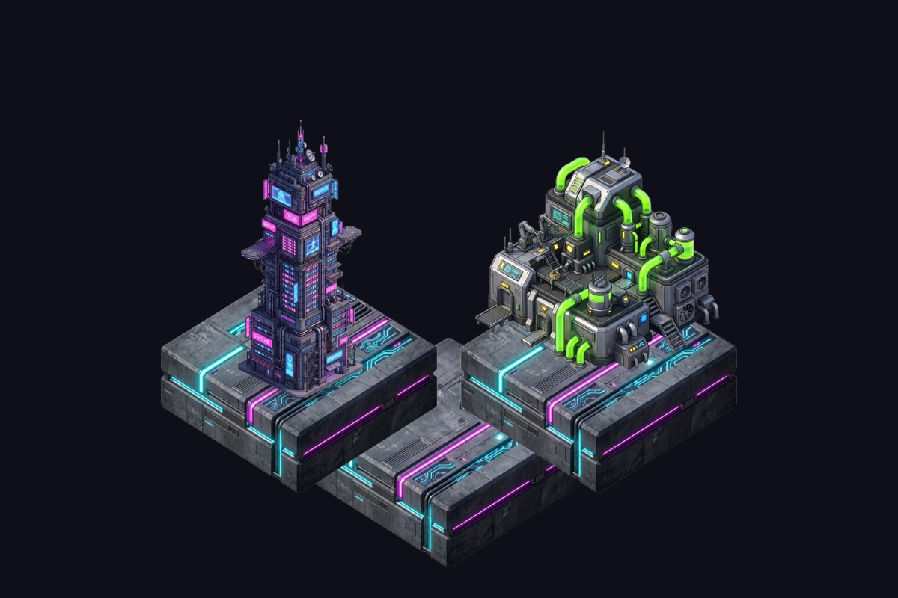

# 💫 About Me:
🔭 I’m currently working on Ml algorithms implementation and 3d web app development 👯 I’m looking to collaborate on Ai/Ml projects,vibe coding and prompt engineering  🤝 I’m looking for help with Ai/Ml, vibe coding , 3d web app development and prompt engineering 🌱 I’m currently learning Ml algo's 💬 Ask me about how to create an efficient prompt? , how to build interactive website ? , what's agent will perform best according to task? ⚡ Fun fact -> i'm a music lover , love to do Workout in free time

## 🌐 Socials:
  

# 💻 Tech Stack:
                                                                        
# 📊 GitHub Stats:
 
 

## 🏆 GitHub Trophies

### ✍️ Random Dev Quote

### 🔝 Top Contributed Repo

---

<!-- Proudly created with GPRM ( https://gprm.itsvg.in ) -->

